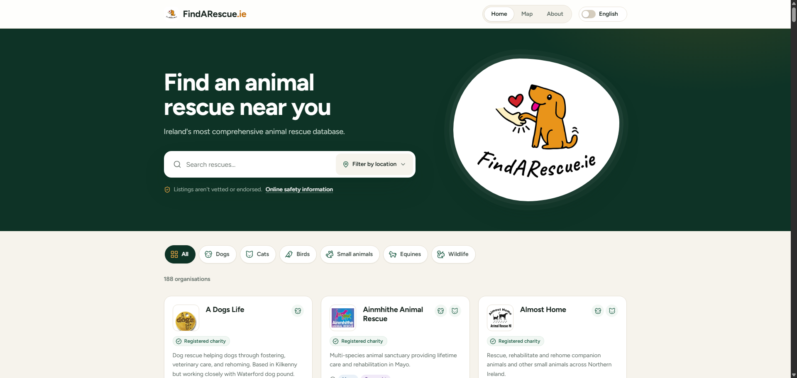
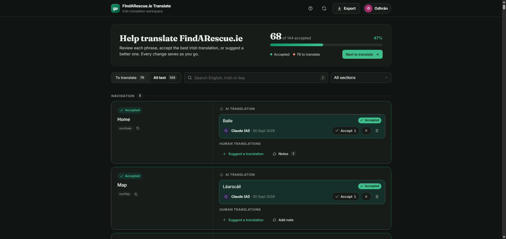

# FindARescue.ie

Source for [FindARescue.ie](https://findarescue.ie), a directory of animal rescues, shelters and welfare organisations across Ireland, and its companion translation tool, [translate.findarescue.ie](https://translate.findarescue.ie), which has its own repository: [translate.findarescue.ie](https://github.com/odhranroche/translate.findarescue.ie).

This repository holds the main site. The translation tool sits inside `public_html/translate/`, matching the server layout, but it is a **separate git repository** that this one ignores.

| Part | What it is | Location |
|---|---|---|
| **Main site** | The public directory, available in English and Irish (Gaeilge) | `public_html/` |
| **Translation tool** | A separate web app where volunteers review and vote on Irish translations | `public_html/translate/` (own repo: [translate.findarescue.ie](https://github.com/odhranroche/translate.findarescue.ie)) |

---

## The main site



A static, framework-free site: plain HTML, CSS and JavaScript. Visitors can browse and search rescues by animal type (dogs, cats, birds, small animals, equines, wildlife) and by province or county, and each entry links to the rescue's website, donation page and social media. There is also a map page and an About page.

### Structure

```
public_html/
├── index.html         Directory page
├── map.html           Map page
├── about.html         About page
├── resources.js       The data: one entry per rescue
├── translations.js    Every interface string, in English (en) and Irish (ga)
├── app.js             Directory logic: filtering, search, rendering
├── style.css          All styles
├── icons.svg          Icon sprite
├── images/            Site images and rescue logos (images/RescueLogos/)
├── robots.txt
├── sitemap.xml
└── translate/         Translation tool (separate repository, not tracked here)
```

### How it fits together

- **`resources.js`** defines a global `resources` array. Each entry has a title, description, animal category, location tags (province and county), logo, and links for website, donation, location, Instagram and Facebook, plus a charity number where there is one. **To add or edit a rescue, edit this file** and add its logo to `images/RescueLogos/`.
- **`translations.js`** holds each interface string once under `en` and once under `ga`, with the same keys in both. HTML elements opt in with `data-i18n` attributes. Irish values that are still English placeholders are marked `// TODO (ga)`. A rescue's Irish description is stored in an optional `description_ga` field in `resources.js`, and English is shown when it is missing.
- **`app.js`** reads both of those files to build the page. The script order in `index.html` matters: `resources.js`, then `translations.js`, then `app.js`, loaded synchronously with no `defer` or `async`.
- **Adding an animal category:** add it to `CATEGORY_CONFIG` in `app.js`, add its label key to both `en` and `ga` in `translations.js`, and add its icon to `icons.svg`.

### Hosting

The site runs on Hostinger shared hosting (PHP and MySQL, no Node or Python). Changes are deployed by uploading files to `public_html/`.

---

## The translation tool



[translate.findarescue.ie](https://translate.findarescue.ie) is a small PHP and MySQL web app that lets several volunteers work together on the Irish version of the site's interface text. Some of that text starts as AI-generated Irish, and people review it, propose better versions and vote on them.

- It reads this site's `translations.js`, shows each string with its AI and human translations, and lets contributors add translations and notes.
- Each translator gets one Accept or Reject vote per translation, and the best-supported translation wins.
- It exports a ready-to-paste `ga: { ... }` block, which is then copied into `translations.js` on the main site.

**Code, setup instructions and behaviour notes are in its own repository: [odhranroche/translate.findarescue.ie](https://github.com/odhranroche/translate.findarescue.ie).**

---

## Notes for working on this repo

- **`public_html/translate/` is ignored by this repo.** It has its own git repository inside it. Run git commands for the main site from the top-level `findarescue.ie/` folder, and for the translation tool from inside `public_html/translate/`.
- **The database is not in git.** The translation tool's data (translations, votes and notes) lives in MySQL on Hostinger. Export a dump from phpMyAdmin to back it up.
